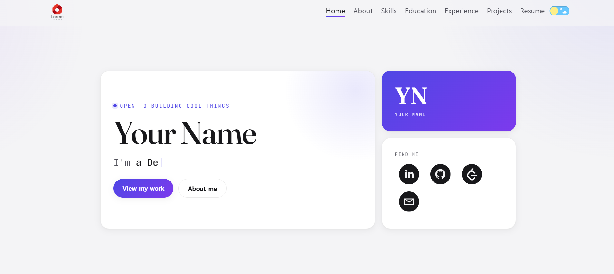

# README & Weekly Review
## 1.Project Information :<br>
프로젝트 소개 : 개발자 포트폴리오, 개발자 프로필<br>
원본 URL 및 라이선스 : https://github.com/mayankagarwal09/dev-portfolio, License : MIT License    Copyright (c) 2022 Mayank Agarwal<br>
선정 이유 : 이 코드를 통해 React 구조와 컴포넌트 등을 이해할 수 있고 앞으로 개발자로 성장하면서 저의 역량과 경험 등을 보여줄 수 있는 포트폴리오가 필요하다고 생각되어 선택하였습니다.

## 2. Installation :<br>
원본 Fork 후<br>
git clone https://github.com/hyungeun02/dev-portfolio.git <br>
cd dev-portfolio<br>
npm install<br>
npm run dev


## 3.Source Code Exploration:<br>
1. Project Structure:<br>
- home.json : 홈 화면에 표시되는 이름, 간단한 설명, 간단한 메시지 등을 보여주는 파일. .json 파일들은 데이터들을 저장하여 보여줄 수 있는 역할을 합니다.
- Home.jsx : React 컴포넌트로 UI를 구성할 수 있도록 작성하는 파일. 홈 화면과 이름, 간단한 설명, 간단한 메시지 등을 화면에 보여주고 다른페이지로 이동하는 버튼이 있습니다.<br>
-themes.js : js로 만들어진 파일. 다크 모드, 라이트 모드일 때의 배경색, 카드 배경색 등을 변경할 수 있습니다<br>
2. React Component:<br>
- Home Component: 홈 화면을 구성하는 React 컴포넌트로 이름, 간단한 설명, 간단한 메시지 등을 화면에 보여주고 다른 페이지로 이동하는 버튼이 있습니다.<br>
- About Component : About을 구성하는 React 컴포넌트로 자기소개 등을 화면에 보여주고 Home으로 돌아가는 버튼이 있습니다.<br>
3. Code Analysis:<br>
Home.jsx의 53~66번 줄<br>
Link를 이용해서 다른 페이지로 이동하는 코드입니다. div를 이용해서 이동하는 버튼들을 묶어주고 className을 지정하였습니다. 버튼을 누를 경우 to="" 로 해당 페이지로 이동합니다. 예를 들어 to="/projects"면 프로젝트 페이지로 이동합니다.

## 4. Customizing:<br>
라이트 모드와 다크 모드의 배경 색을 변경하였습니다. 하얀색을 하늘색, 검정색을 남색, 어두운 검정색을 어두운 남색으로 변경하였습니다.
또 Home의 이름 등의 글꼴을 변경하였습니다.<br> 포트폴리오 이름, 간단한 설명, 간단한 메시지 등을 변경하고 자기소개 페이지를 변경하고 학적사항을 변경하였습니다. <br>
 Home.jsx에서 다른 페이지로 가는 버튼을 2개 더 추가하였고 about.jsx에서 Home 페이지로 돌아가는 버튼을 만들었습니다. 또 로고도 한동대학교 로고로 변경하였습니다.

## 5. vercel 배포 url:<br>
https://dev-portfolio-u9uj.vercel.app/

## 6. weekly review:<br>
1. 새롭게 배운 내용 3가지 :<br>
- jsx 파일으로 화면에 보여주고 json 파일으로 데이터를 구성하는 등의 react 구조와 역할에 대해서 배울 수 있었습니다.<br>
- Link 컴포넌트를 이용해서 페이지를 이동하는 방법을 배울 수 있었습니다. 이를 통해 사이트를 만들 때 버튼으로 페이지를 왔다 갔다 할 수 있음을 배웠습니다.<br>
- 오픈소스를 이용해서 다른 개발자의 프로그램을 가져오고 수정할 수 있는 것을 배웠습니다. 이를 통해 다른 개발자의 프로그램을 읽어보면서 프로그래밍 실력을 향상할 수 있음을 알 수 있었습니다.<br>
2. 어려웠던 점과 해결방법 : 오픈소스로 받은 코드를 수정하고 Vercel에 배포 과정에서 어려움을 겪었습니다. 개발자의 README를 읽어보면서 문제점을 확인하였고 Vercel에 배포 과정에서 설정을 변경해야 한다는 것을 알고 변경함으로 해결하였습니다. 이를 통해 개발자의 프로그램 방식을 이해하는 것이 중요하다는 것을 알 수 있었습니다.
3. AI 활용 내용과 느낀 점 : AI를 활용하면서 React 구조와 코드에 대해서 더욱 배울 수 있었습니다. AI를 활용하여 다른 개발자의 프로그램을 분석하고 이해하면서 코드를 짤 때 이런 식으로 짜는 것을 알 수 있었고 AI가 코드와 구성을 이해하는데 많은 도움을 주어 AI에 대한 고마움을 느낄 수 있었습니다.


------------------------------------------------------------------------------------------------------------------------

# Dev Portfolio  [](https://github.com/mayankagarwal09/dev-portfolio/blob/master/LICENSE.md) 

## A minimal portfolio template for Developers!

<h2 align="center">
  
  <br>
</h2>

## Features

⚡️ Modern **bento** UI — dark-first, with a light-theme toggle\
⚡️ Built with React 18 + Vite\
⚡️ Design-token theming (restyle the whole site from one place) + refined web fonts\
⚡️ Reveal animations & fully responsive\
⚡️ Data-driven and easily customizable via JSON\
⚡️ Well organized documentation

## Demo

To view the demo: **[click here](https://dev-portfolio-mayankagarwal09.vercel.app)**

## Choosing a version 🧭

This template ships in two UI flavors — pick the one you like:

| Version | UI | Get it | Demo |
| ------- | -- | ------ | ---- |
| **v2** _(latest)_ | Modern bento, dark-first | default branch / [latest release](https://github.com/mayankagarwal09/dev-portfolio/releases/latest) | [live](https://dev-portfolio-mayankagarwal09.vercel.app) |
| **v1** | Classic | [`v1`](https://github.com/mayankagarwal09/dev-portfolio/tree/v1) branch / `v1.x` release | [live](https://dev-portfolio-mayankagarwal09-v1.vercel.app) |

```bash
# New UI (v2) — default
git clone https://github.com/mayankagarwal09/dev-portfolio

# Classic UI (v1)
git clone -b v1 https://github.com/mayankagarwal09/dev-portfolio
```

## Why do you need a portfolio? ☝️

- Professional way to showcase your work
- Increases your visibility and online presence
- better chance of getting work opportunity

---

## Getting Started 🚀

These instructions will get you a copy of the project up and running on your local machine for development and testing purposes. See deployment for notes on how to deploy the project on a live system.

### Prerequisites 📋

You'll need [Git](https://git-scm.com) and [Node.js **18+**](https://nodejs.org/en/download/) (which comes with [NPM](http://npmjs.com)) installed on your computer.

Also, you can use [Yarn](https://yarnpkg.com/) instead of NPM ☝️

> This project is built with [Vite](https://vitejs.dev/) and React 18.

## Setup 🔧

From your command line, first clone Dev Portfolio:

```bash
# Clone the repository
$ git clone https://github.com/mayankagarwal09/dev-portfolio

# Move into the repository
$ cd dev-portfolio

# Remove the current origin repository
$ git remote remove origin
```

After that, you can install the dependencies either using NPM or Yarn.

Using NPM: Simply run the below commands.

```bash
# Install dependencies
$ npm install

# Start the development server
$ npm run dev
```

Using Yarn:

```bash
# Install dependencies
$ yarn

# Start the development server
$ yarn dev
```

Once your server has started, go to this url `http://localhost:3000/` to see the portfolio locally.
The page will reload if you make edits.

To run the test suite ([Vitest](https://vitest.dev/)):

```bash
$ npm test
```

---

## Customization Instructions:

### Step 1 - DATA & IMAGES

All customizable files are inside the `public/` folder, organised mainly into `public/images/` and `public/profile/`.
- `public/images` contains all the image assets that can be customized on website
- `public/profile` contains all text and info inside json files that can be customized according to need

### (1) NavBar

- Open `public/profile/navbar.json` 
It has 2 keys, *logo* and *sections*.

```
{
    "logo" : {
        "source": "images/logo.png",
        "height" : 45,
        "width" : 50
    },
    "sections": [
        {
            "title": "Home",
            "href": "/"
        },
        {
            "title": "About",
            "href": "/about"
        },
        {
            "title": "Skills",
            "href": "/skills"
        },
        {
            "title": "Education",
            "href": "/education"
        },
        {
            "title": "Experience",
            "href": "/experience"
        },
        {
            "title": "Projects",
            "href": "/projects"
        },
        {
            "title": "Resume",
            "href": "https://drive.google.com/file/d/13kaPsdMNDsM4LV9g7m5-E5PTildp-yYf/view?usp=sharing",
            "type": "link"
        }
    ]
}
```

| key | Description |
| ----------- | ----------- |
| logo | image you want to show as brand image on NavBar. It can be also be a simple logo with just your intitials|
| logo.source | path to the logo image |
| logo.height | height of logo |
| logo.width | width of logo |
| sections | array of sections that you want to show on Navbar as links | 
| sections.title | title of the section | 
| sections.href | link to that section. Same as *path* mentioned in `routes.json` | 
| sections.type | Opens in a new tab if value is *link*. `optional` field | 

### (2) Routes
- open `public/profile/routes.json`

```
{
    "sections": [
        {
            "component": "About",
            "path": "/about",
            "headerTitle": "About"
        },
        {
            "component": "Skills",
            "path": "/skills",
            "headerTitle": "Skills"
        },
        {
            "component": "Education",
            "path": "/education",
            "headerTitle": "Education"
        },
        {
            "component": "Experience",
            "path": "/experience",
            "headerTitle": "Experience"
        },
        {
            "component": "Projects",
            "path": "/projects",
            "headerTitle": "Projects"
        }
    ]
}
```

| key | Description |
| ----------- | ----------- |
| sections | array of sections that you want to create route for | 
| sections.component | name of the Component. No need to change it unless you want to customize the entire Component. | 
| sections.path | route for the particular section. this is the path where the particular section will be accessible | 
| sections.headerTitle | title to be shown on the top of that section page | 

- For component customization, create a component of your own inside `src/components/` and use name of that component here.

### (3) Home Section

#### Home Info
- open `public/profile/home.json`

```
{
    "name": "Your Name",
    "roles": ["a Developer", "a Freelancer"],
    "status": "Open to building cool things"
}
```

| key | Description |
| ----------- | ----------- |
| name | your name | 
| roles | string array separated by `,`. mention your roles here | 
| status | short availability/status label shown (with a dot) above your name. Hidden if omitted. `optional` field | 

#### Social Links
- open `public/profile/social.json`

```
{
    "social": [
        {
            "network" : "linkedin",
            "href": "https://linkedin.com/"
        },
        {
            "network" : "github",
            "href": "https://github.com/"
        },
        {
            "network" : "leetcode",
            "href": "https://leetcode.com/"
        },
        {
            "network" : "email",
            "href": "mailto:test@test.com"
        }
    ]
}
```

| key | Description |
| ----------- | ----------- |
| social | array of social links | 
| social.network | network name as provided in [react-social-icons](https://jaketrent.github.io/react-social-icons/) |
| social.href | link for particular social network |

- we are using [react-social-icons](https://jaketrent.github.io/react-social-icons/) here. you can visit it to see all available social icons to use
- popular coding profiles like `leetcode` are supported out of the box — just add an entry with that `network` name

### (4) About Section

- open `public/profile/about.json`

```
{
    "about": " This is where you can describe about **yourself**.",
    "imageSource": "images/about/profile.png"
    
}
```

| key | Description |
| ----------- | ----------- |
| about | write about yourself, your works and goals here. `markdown` supported | 
| imageSource | path to your profile image. (recommended size 400 x 450) |

### (5) Skills Section

- open `public/profile/skills.json`

```
{
    "intro": "I love to learn new things and experiment with new technologies.\nThese are some of the major languages, technologies, tools and platforms I have worked with:",
    "skills": [{
     
            "title": "Languages",
            "items" : [
     
                {
                    "icon": "images/skills/java.png",
                    "title": "Java"
                },
                {
                    "icon": "images/skills/js.png",
                    "title": "JavaScript"
                }
        ]},
        {
            "title": "Frameworks & Technologies",
            "items" : [
                {
                    "icon": "images/skills/react.png",
                    "title": "React"
                }
            ]
        },
        {
            "title" : "Tools & Platforms",
            "items": [
                {
                    "icon": "images/skills/git.png",
                    "title": "Git"
                }
            ]
    }
]}
```

| key | Description |
| ----------- | ----------- |
| intro | small introduction line related to your skills. `markdown` supported | 
| skills | array containing skills under different categories |
| skills.title | title for category under which you want to list particular skills |
| skills.items | array containing skills for this category |
| skills.items.icon | path to skill logo |
| skills.items.title | title of skill |

- many pre existing skill logos are available inside `public/images/skills`.

### (6) Education Section

- open `public/profile/education.json`

```
{
    "education":[
        {
            "title": "Jun 20XX - Jun 20YY",
            "cardTitle": "B.Tech, Computer Science",
            "cardSubtitle":"XYZ University, City",
            "cardDetailedText": "CGPA - 9.5",
            "icon" : {
                "src": "images/education/lorem-ipsum.png"
            }
        },
        {
            "title": "Apr 20XX",
            "cardTitle": "High School",
            "cardSubtitle":"ABC School, City",
            "cardDetailedText": "Marks - 95%"
        }
    ]
}
```

| key | Description |
| ----------- | ----------- |
| education | array containing education history of a person | 
| education.title | date range during which this education was pursued or passing date |
| education.cardTitle | degree or course name |
| education.cardSubtitle | school or institute name |
| education.cardDetailedText | extra info such as marks or cgpa |
| education.icon | icon shown on the timeline. `optional` field|
| education.icon.src | path to icon |

### (7) Experience Section

- open `public/profile/experiences.json`

```
{
    "experiences": [
        {
            "title": "Software Engineer",
            "subtitle": "XYZ Ltd",
            "workType": "Full-time",
            "workDescription": [
                "Integrated **2** new product.",
                "Worked on adding **def** to **bcd**. Improved speed by 50%."
            ],
            "dateText": "06/20XX – Present"
        },
        {
            "title": "Software Engineer",
            "subtitle": "XYZ Ltd",
            "workType": "Internship",
            "workDescription": [
                "Worked on abc."
            ],
            "dateText": "01/20XX – 05/20XX"
        },
        {
            "title": "App Developer",
            "subtitle": "ABC Pvt Ltd",
            "workType": "Freelance",
            "workDescription": [
                "Developed the official apps for the startup for both Android and iOS using hybrid framework.",
                "Done bcd work."
            ],
            "dateText": "09/20XX – 01/20YY"
        }
    ]
}
```

| key | Description |
| ----------- | ----------- |
| experiences | array containing work experiences of a person | 
| experiences.title | role or designation title |
| experiences.subtitle | company or organization name. `optional` field |
| experiences.workType | type of work experience. example - internship, freelance, full-time. `optional` field |
| experiences.workDescription | string array to highlight specific points related to that work experiece. `markdown` supported |
| experiences.dateText | date range text during which particular work experience was pursued. |

### (8) Projects Section

- open `public/profile/projects.json`

```
{
    "projects" : [
        {
            "image" : "images/projects/portfolio-poster.png",
            "title": "Dev Portfolio",
            "bodyText": "- Developer Portfolio Website made in React\n -  Fully customisable and dynamic, easily change data and images.\n - Dark Mode Support",
            "links": [
                {
                    "text": "GitHub",
                    "href": "https://github.com/mayankagarwal09/dev-portfolio"
                },
                {
                    "text": "Live",
                    "href": "https://mayankagarwal.me"
                }
            ],
            "tags" : [
                "React",
                "Portfolio",
                "JavaScript"
            ]
        },
        {
            "title": "MVVM Sample App",
            "bodyText": "- An Android App that loads data from mock API and show in both **LinearLayout** and **GridLayout RecyclerView**.\n - Offline support using **Room** DB and **NetworkBoundResource**.\n - Uses the **MVVM** architecture.",
            "links": [
                {
                    "text": "GitHub",
                    "href": "https://github.com/mayankagarwal09/mvvm-sample-app"
                }
            ],
            "tags" : [
                "Kotlin",
                "Android",
                "MVVM",
                "Room",
                "Coroutines",
                "Flow",
                "Hilt-Dagger",
                "NetworkBoundResource"
            ]
        },
        {
            "title": "Task Tracker",
            "bodyText": "- A simple Task Tracker web app made with **Angular 12**.\n - Uses **mock JSON server** to get, add, delete or update tasks.",
            "links": [
                {
                    "text": "GitHub",
                    "href": "https://github.com/mayankagarwal09/task-tracker-app"
                }
            ],
            "tags" : [
                "TypeScript",
                "Angular 12",
                "JavaScript"
            ]
        }
    ]
}
```


| key | Description |
| ----------- | ----------- |
| projects | array containing projects information |
| projects.image | add project poster here. `optional` field. |
| projects.title | title of the project |
| projects.bodyText | description of project. `markdown` supported |
| projects.links | clickable links related to the project. `optional` field |
| projects.links.text | title of link to display |
| projects.links.href | actual link to be redirected to on click of the button |
| projects.tags | string array containing tags related to projects. `optional` field | 

### (9) Resume Section

- It is a clickable link which opens the link provided (generally drive link of resume file) in the navbar.json under Resume.


### Step 2 - STYLES

The look is driven by **design tokens** in two files:

- `src/theme/themes.js` — the light/dark palettes. Edit the HEX values (background, text, a single `accentColor` plus `accentColor2` used only for gradients, surfaces, borders, shadows, navbar) under `lightTheme` and `darkTheme`.
- `src/theme/GlobalStyles.js` — publishes those values, plus spacing, radius, shadow, motion and font tokens, as CSS custom properties (`var(--accent)`, `var(--space-4)`, …) consumed across `src/css/`.

The site is **dark by default** (`useDarkMode(true)` in `src/App.jsx`), with a toggle in the navbar.

```js
// src/theme/themes.js — dark palette (excerpt)
export const darkTheme = {
  background: '#09090b',
  color: '#f4f4f5',
  textMuted: '#a1a1aa',
  accentColor: '#818cf8',   // the single accent
  accentColor2: '#c084fc',  // used only for gradients
  cardBackground: '#141417',
  cardBorderColor: 'rgba(255, 255, 255, 0.08)',
  navbarBackground: 'rgba(9, 9, 11, 0.62)',
  // …shadows, navbarTheme, bsPrimaryVariant / bsSecondaryVariant
};
// lightTheme mirrors these with light values.
```

**Fonts** load in `index.html` (Inter, Fraunces, JetBrains Mono). Change the Google Fonts `<link>` and the `--font-*` tokens to swap them.

### Step 3 - EXTRA

Go to `index.html` (in the project root). Change *title* and *logo* if you want to customize it.

---

## Deployment 📦

Once you finish your setup. You need to put your website online!

First create a production build. Vite outputs the static site to the `build/` folder:

```bash
$ npm run build
```

Deploy that `build/` folder to any static host. I highly recommend [Vercel](https://vercel.app) because it is super easy.

### Single-page-app routing ☝️

This app uses client-side routing (`BrowserRouter`), so a static host must serve `index.html` for **every** path. Without this, refreshing or directly opening a route like `/projects` returns a **404**. Add the matching rewrite for your host:

- **Vercel** — add a `vercel.json` in the project root:

```json
{ "rewrites": [{ "source": "/(.*)", "destination": "/index.html" }] }
```

- **Netlify** — add `public/_redirects`:

```
/*  /index.html  200
```

- **GitHub Pages** — copy `build/index.html` to `build/404.html` after building.

## Notable Portfolios made using this template

- [Mayank Agarwal](https://mayankagarwal09.com)

## Authors

- **Mayank Agarwal** - [https://github.com/mayankagarwal09](https://github.com/mayankagarwal09)

## Support

If you find a bug, feel free to [open an issue](https://github.com/mayankagarwal09/dev-portfolio/issues) in this repository.

## License 📄

This project is licensed under the MIT License - see the [LICENSE.md](LICENSE.md) file for details

